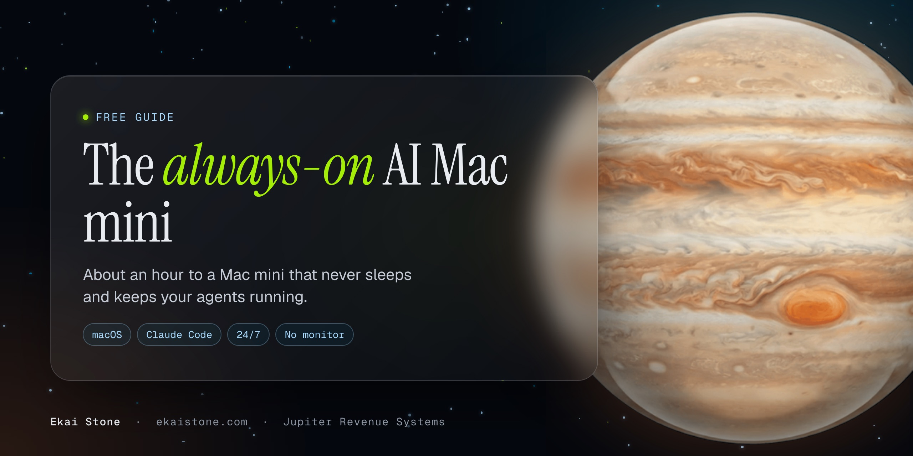

# Always-On AI Mac Mini

About an hour to a Mac mini that never sleeps, comes back by itself after a power cut, runs with no monitor, and has your AI agents logged in and ready.

Every screen is shown, with the exact button to click.

By Ekai Stone, Jupiter Revenue Systems.

## Who it's for

Coaches, consultants, creators, agencies and service businesses that want AI agents running sales and ops, not just a chat window.

## What you end up with

- A Mac mini that never sleeps, and turns itself back on after a power cut.
- It runs with no monitor. You see and control it from your main Mac.
- Claude Code and the Claude app installed and signed in.
- Your business folder always downloaded on it, so your agents always have your files.
- Agent chats you start from your main Mac that run on the Mac mini.
- Your own GitHub account connected.

## What you need

- A Mac mini and its power cord.
- A monitor, keyboard and mouse, just for the first hour. Wired is easiest.
- An Ethernet cable from your router. Wired beats Wi-Fi.
- A battery backup (UPS) for the Mac mini and your router. See [Power and troubleshooting](guide/power-and-troubleshooting.md) for which kind.
- A password manager, to save the new Mac password.
- Your main Mac, on the same network.
- A paid Claude plan.
- Your own GitHub account.
- Optional: an HDMI dummy plug. It's a small plug that makes the Mac mini think a monitor is attached.

## The guide

1. [Unbox and plug in](guide/01-unbox-and-plug-in.md)
2. [The first setup screens](guide/02-first-setup-screens.md)
3. [Remote access](guide/03-remote-access.md)
4. [Always on](guide/04-always-on.md)
5. [Install the apps](guide/05-install-the-apps.md)
6. [Go headless (no monitor)](guide/06-go-headless.md)
7. [Your business folder](guide/07-business-folder.md)
8. [Log in to Claude Code](guide/08-log-in-to-claude-code.md)
9. [Reach it from your main Mac (Remote Control)](guide/09-remote-control-from-your-main-mac.md)
10. [Connect your GitHub account](guide/10-connect-github.md)

Then: [Power and troubleshooting](guide/power-and-troubleshooting.md)

More parts (remote control from your phone, connections, phone lines) are coming. Watch the repo to get them.

## Three ways to do it

| Way | What it is | Where |
|---|---|---|
| **DIY** | This guide. Free. | You're here. Start with [Part 1](guide/01-unbox-and-plug-in.md). |
| **Do it with us** | A Strategy Session. We set it up with you. $750. | https://ekaistone.com/strategy-session |
| **Done for you** | Included in the Seven Star Build. | https://ekaistone.com/seven-star/build |

## License

[CC BY 4.0](LICENSE). Share it and adapt it. Credit Jupiter Revenue Systems.

---

Built by Jupiter Revenue Systems, https://ekaistone.com. Star the repo if it helps.
