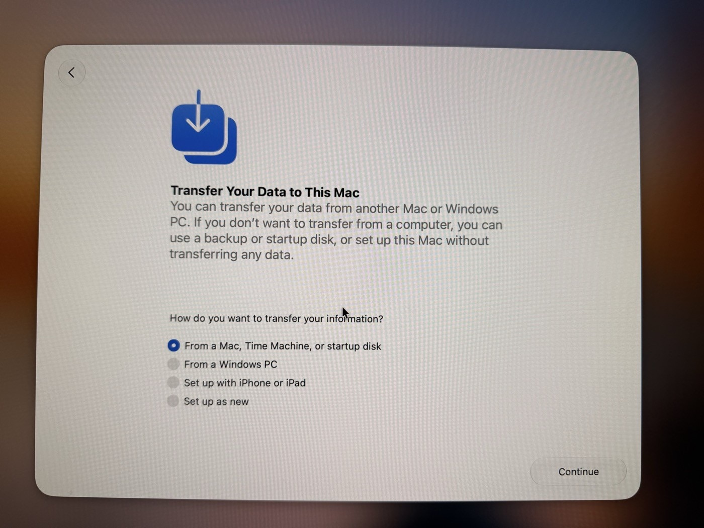
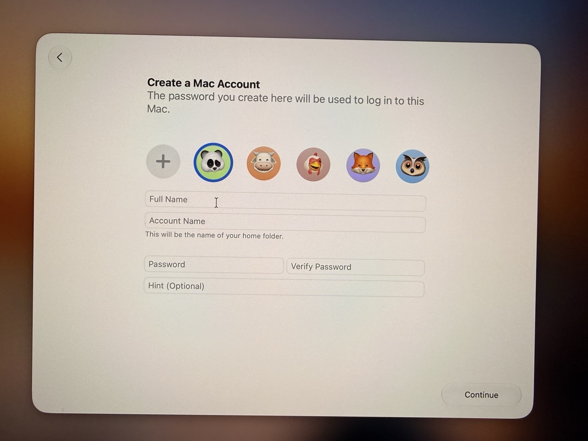

# Part 2. The first setup screens

[Back to the contents](../README.md#the-guide)

## Step 3. Language, region, Wi-Fi

Pick your language and country. Ethernet is already plugged in, so skip Wi-Fi if it asks.

## Step 4. "Transfer Your Data to This Mac"

Pick **Set up as new**, then click **Continue**.

Why: your old Mac has personal files, old apps and its own settings. Copying them over mixes everything up. Your files come through iCloud anyway.

## Step 5. Sign in with your Apple Account

Use your main Apple Account, the same one as on your main Mac. That's how the Mac mini gets your iCloud Drive.

## Step 6. "Create a Mac Account"

- **Full Name:** your Mac mini's name + "Admin" (for example "Atlas Admin"). You can change this later.
- **Account Name:** lowercase, no spaces (for example `atlasadmin`). This one is hard to change later.
- **Password / Verify Password:** a strong new one. Save it in your password manager right now. Never send it to anyone.
- **Hint (Optional):** leave it blank.

Then click **Continue**.

## Step 7. FileVault: leave it off

If it asks to turn on FileVault, don't. Automatic login (Step 11) only works with FileVault off. Step 10 shows how to check it, because it can end up on anyway.

## Step 8. Finish setup

Accept the defaults until you see the desktop.

---

Next: [Part 3. Remote access](03-remote-access.md)
