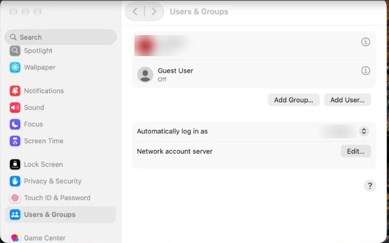

# Part 4. Always on

[Back to the contents](../README.md#the-guide)

## Do it in one command

On the Mac mini, open **Terminal** and paste this. It shows the plan and asks before it changes anything:

```bash
curl -fsSL https://raw.githubusercontent.com/jupiter-revenue-systems/always-on-ai-mac-mini/main/scripts/always-on.sh | bash
```

It sets Step 10's Energy settings, Part 3's Screen Sharing and Remote Login, and restart after a freeze (that one has no switch in System Settings). It only changes what this guide covers. It checks FileVault and automatic login but leaves them to you, since they need your password. Do Step 10's FileVault part and Step 11 by hand.

Other ways to run it:

```bash
curl -fsSL https://raw.githubusercontent.com/jupiter-revenue-systems/always-on-ai-mac-mini/main/scripts/always-on.sh | bash -s -- --dry-run   # show every command, change nothing
curl -fsSL https://raw.githubusercontent.com/jupiter-revenue-systems/always-on-ai-mac-mini/main/scripts/always-on.sh | bash -s -- --status    # current values next to the targets
curl -fsSL https://raw.githubusercontent.com/jupiter-revenue-systems/always-on-ai-mac-mini/main/scripts/always-on.sh | bash -s -- --undo      # put back what it changed
```

Or click through the steps below. Same result.

## Step 10. Never sleep, turn back on after a power cut, FileVault off

On the Mac mini:

1. Open **System Settings → Energy**.
2. Turn on **Prevent automatic sleeping when the display is off**.
3. Turn on **Wake for network access**.
4. Turn on **Start up automatically after a power failure**.
5. Open **System Settings → Privacy & Security → FileVault**.
6. If it says On, click **Turn Off**. It finishes in the background over a few minutes.

## Step 11. Log in by itself after a restart

1. Open **System Settings → Users & Groups**.
2. Set **Automatically log in as** to your Admin user.
3. Type the password when it asks.



---

Next: [Part 5. Install the apps](05-install-the-apps.md)
