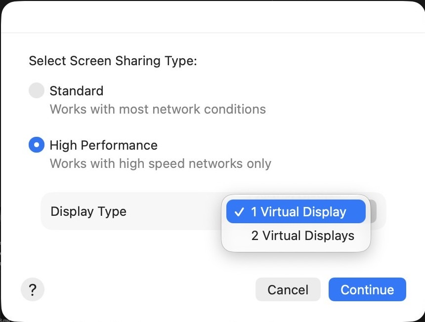
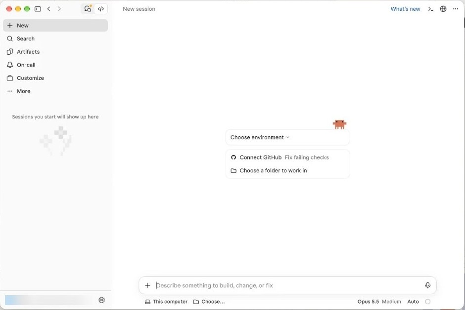
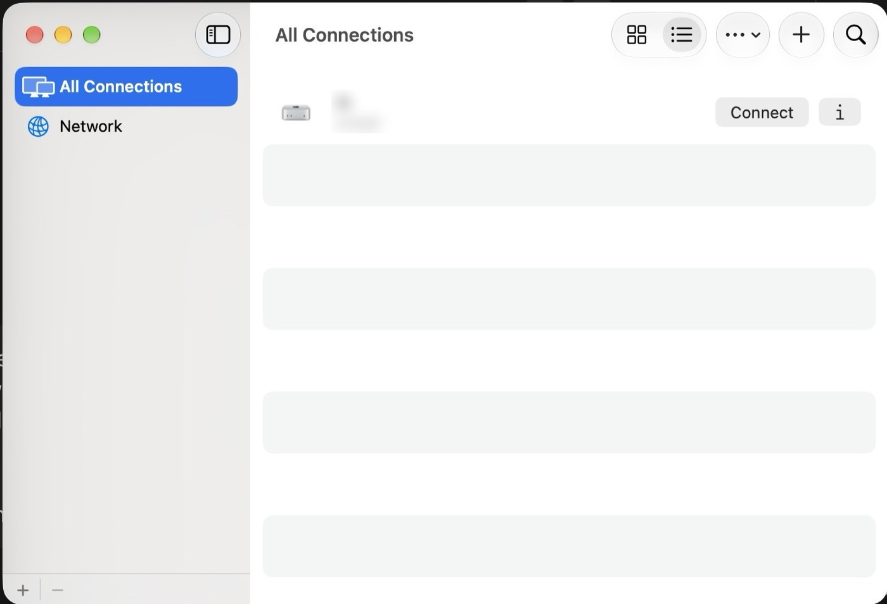

# Part 6. Go headless (no monitor)

[Back to the contents](../README.md#the-guide)

## Step 16. Test Screen Sharing from your main Mac

1. On your main Mac, open **Terminal**.
2. Run this, with your Mac mini's name in place of `<name>`:

```bash
open vnc://<name>.local
```

3. At "Select Screen Sharing Type", pick **High Performance**. This works best when both Macs are wired to the same router.
4. Set **Display Type** to **1 Virtual Display**. It gives you a sharp screen even with no monitor plugged in.
5. Click **Continue**.
6. Log in with the Mac mini's account name and password.



## Step 17. Check you can see it

If the Mac mini's desktop shows on your main Mac, it works.



## Step 18. Unplug and test again

1. Close the Screen Sharing window with the red button. The Mac mini keeps running.
2. Unplug the monitor, keyboard and mouse from the Mac mini.
3. On your main Mac, open the **Screen Sharing** app (Cmd + Space, type "Screen Sharing").
4. Your Mac mini is saved under **All Connections**. Click **Connect**.

Tip: right-click Screen Sharing in the Dock, then pick **Options → Keep in Dock**. Now it's one click away.



From here on, do everything on the Mac mini through Screen Sharing.

---

Next: [Part 7. Your business folder](07-business-folder.md)
