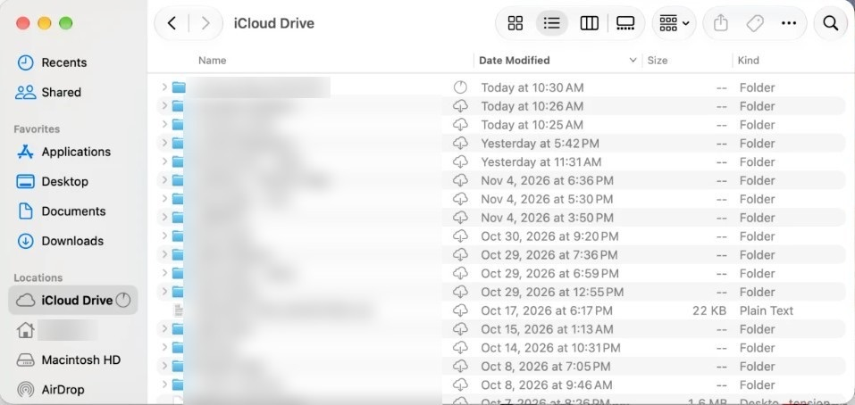

# Part 7. Your business folder

[Back to the contents](../README.md#the-guide)

## Step 19. Make your business folder

If you don't have one yet:

1. In Finder, open **iCloud Drive**.
2. Make a folder for your business, for example "My Business".

This is where your agents read and save their work.

## Step 20. Keep it downloaded on the Mac mini

1. Open **Finder**.
2. In the sidebar, under Locations, click **iCloud Drive**.
3. Right-click your business folder and pick **Keep Downloaded**.
4. A progress circle shows next to it while it downloads.

The other folders keep a cloud icon. They stay in the cloud, and that's what you want.

Tip: keep **only** your business folder downloaded, so the Mac mini's disk stays light.

Why: agents work at night. A file that's only in the cloud may not be there when they need it.

---

Next: [Part 8. Log in to Claude Code](08-log-in-to-claude-code.md)
