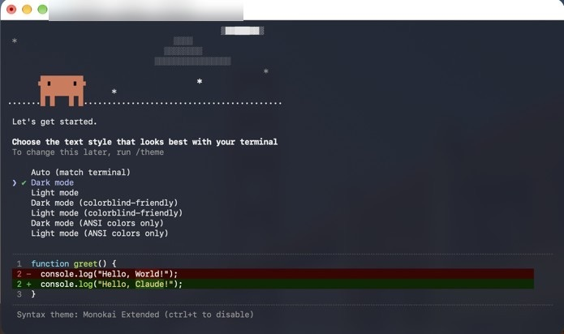
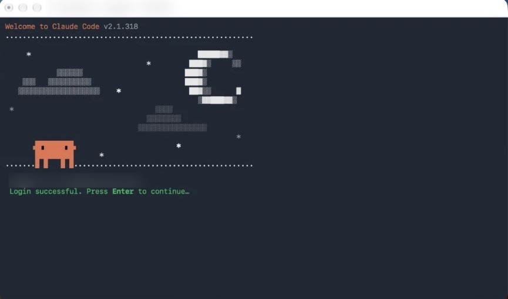
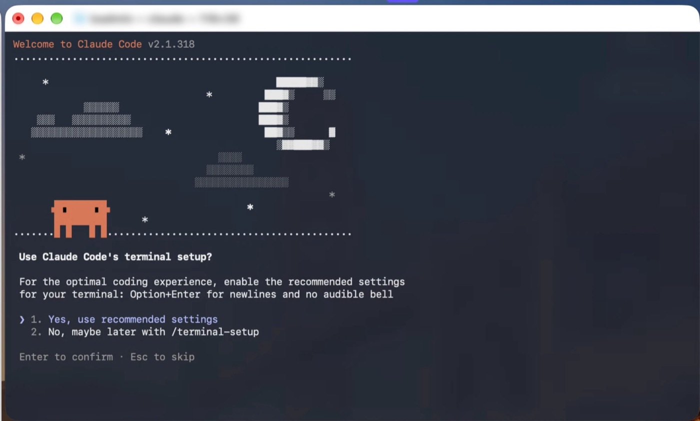
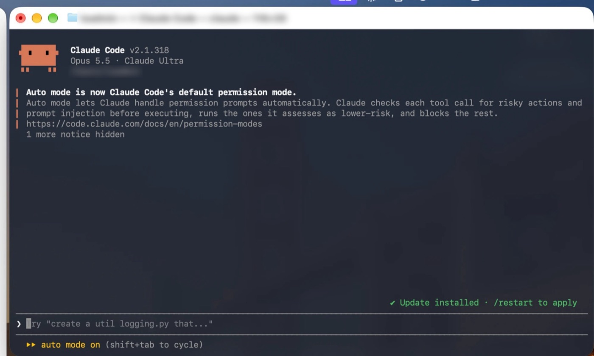
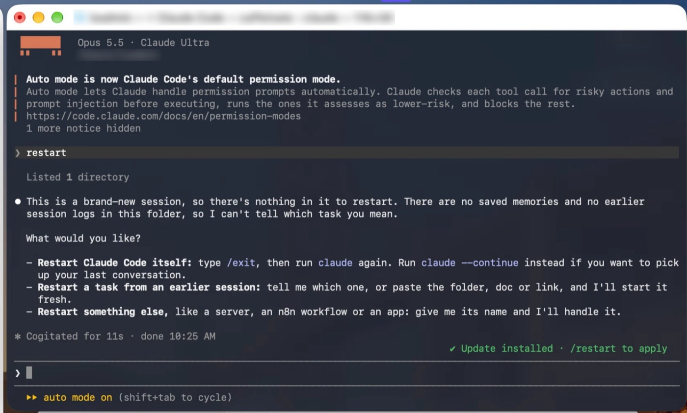
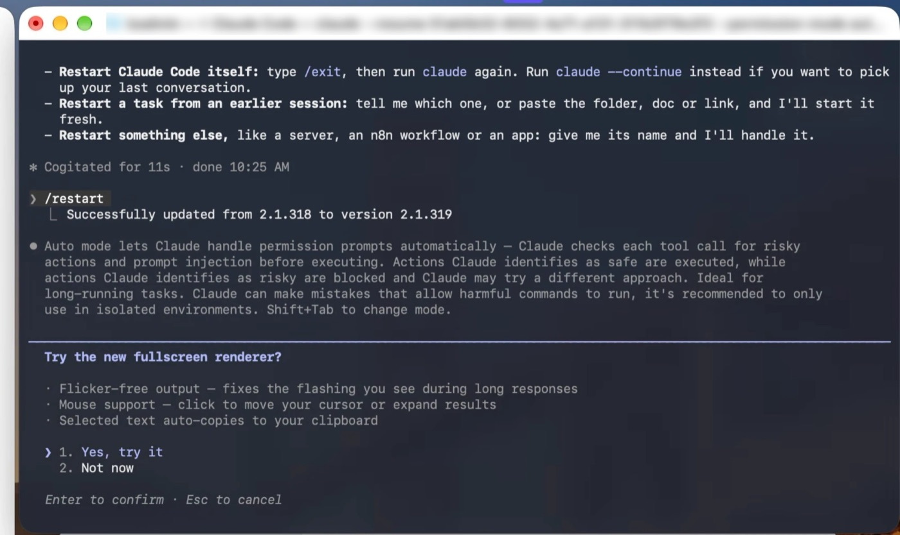
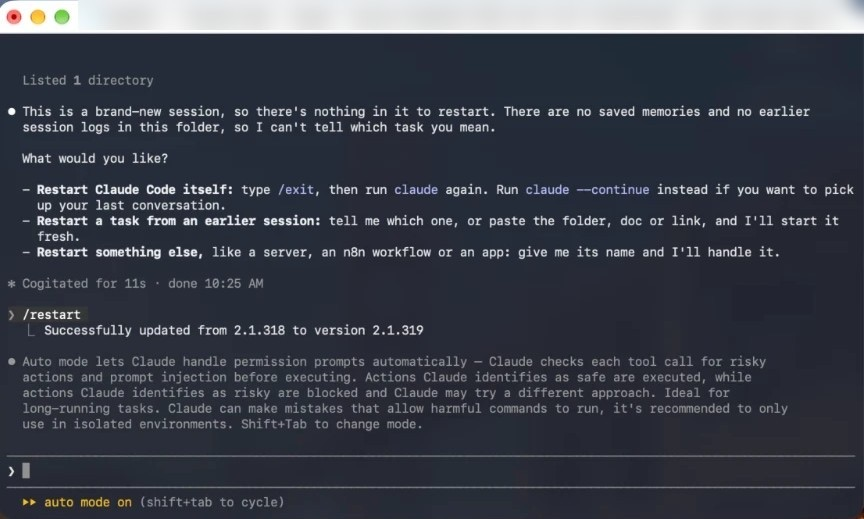

# Part 8. Log in to Claude Code

[Back to the contents](../README.md#the-guide)

## Step 21. Start Claude Code in your business folder

1. Open **Terminal**.
2. Type `cd ` (with a space after it).
3. Drag your business folder from Finder into the Terminal window, and press Return.
4. Type `claude` and press Return.

Start Claude in your business folder, not your home folder. That way it sees your business files.

## Step 22. "Choose the text style"

**Dark mode** is already picked. Press **Return**.

## Step 23. Log in

1. Pick **Claude account with subscription** and press Return.
2. The browser opens. Sign in if it asks.
3. Click **Authorize**.
4. Back in Terminal you'll see "Login successful. Press Enter to continue…". Press **Return**.

## Step 24. "Use Claude Code's terminal setup?"

**1. Yes, use recommended settings** is already picked. Press **Return**.

## Step 25. Trust the folder

If it asks "Do you trust the files in this folder?", pick **Yes**.

## Step 26. You're in

The home screen shows the model, your plan and your folder. The bottom says "auto mode on".

## Step 27. If it says "Update installed · /restart to apply"

Type `/restart` **with the slash** and press Return. It shows "Successfully updated…".

Careful: if you type `restart` without the slash, Claude reads it as a normal message and just chats back. Commands always start with `/`.

## Step 28. "Try the new fullscreen renderer?"

Pick **1. Yes, try it** and press Return. It gives you smoother output and mouse support, which helps over Screen Sharing.

## Step 29. Check, then close Terminal

1. Type `/status` and press Return. It shows the account you're logged in with.
2. Type `/exit` and press Return.
3. Quit Terminal with **Command + Q**.

Your day-to-day chats run in the **Claude app**. The Terminal login just makes sure Claude Code works on this Mac.

---

Next: [Part 9. Reach it from your main Mac (Remote Control)](09-remote-control-from-your-main-mac.md)
