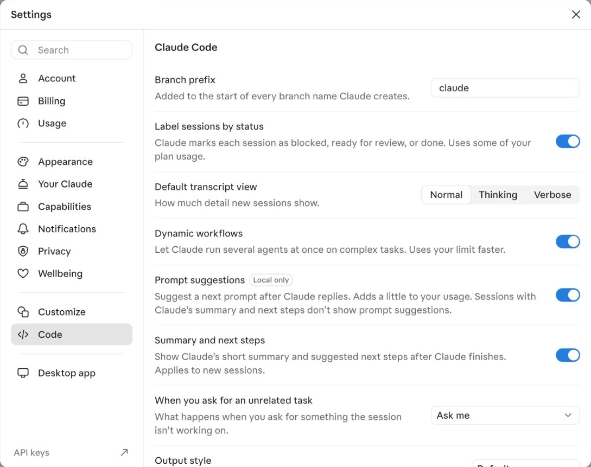
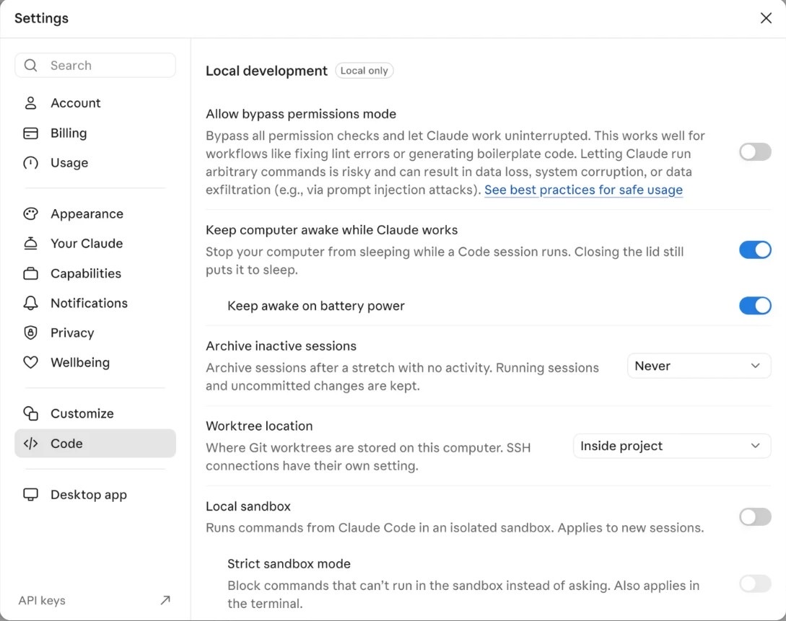
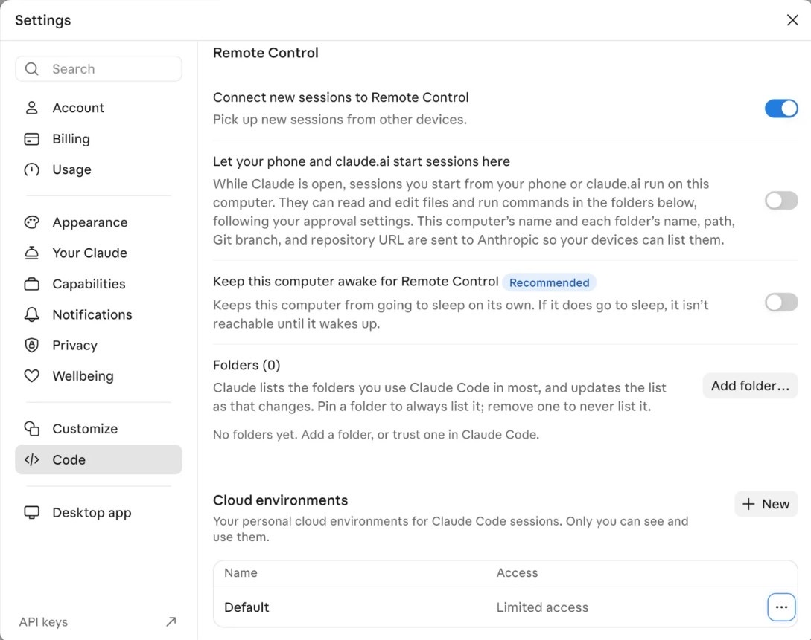
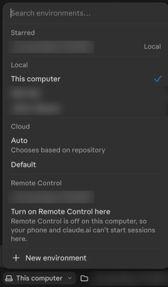
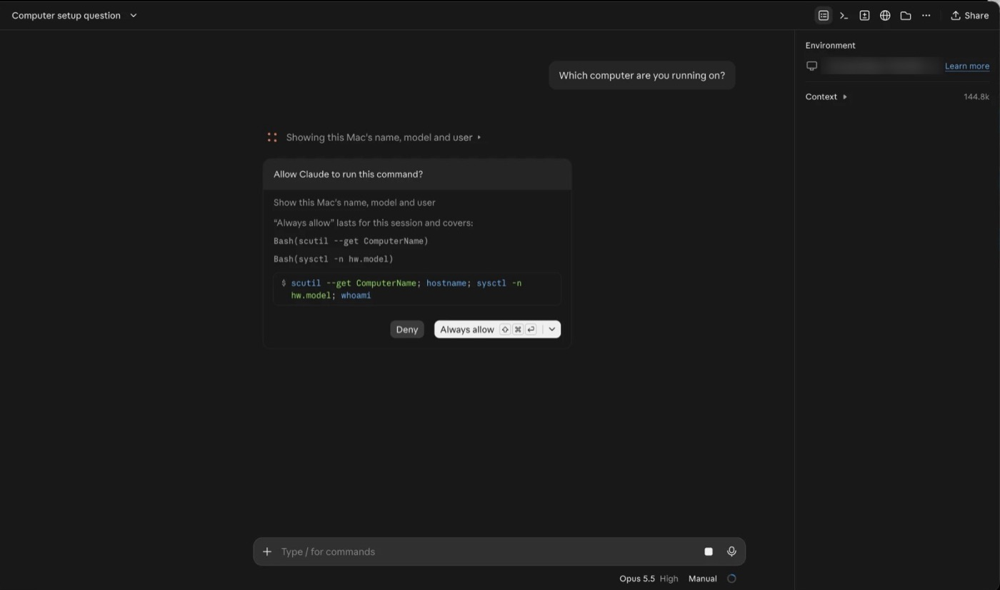
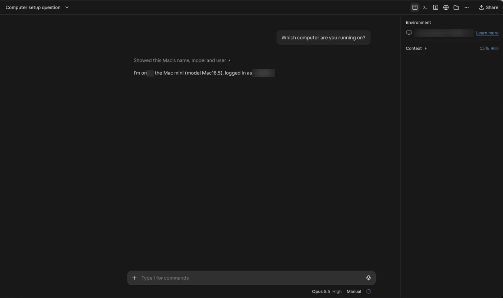

# Part 9. Reach it from your main Mac (Remote Control)

[Back to the contents](../README.md#the-guide)

## Step 30. Open the Claude app's settings

On the Mac mini:

1. Open the **Claude** app.
2. Press **Command + ,** (comma).
3. In the left sidebar, click **Code**.

## Step 31. Leave these as they are

Under **Local development**:

- **Allow bypass permissions mode:** off.
- **Keep computer awake while Claude works:** on.
- **Local sandbox:** off.

Leave everything else on its default too.

## Step 32. Turn on Remote Control

In the **Remote Control** section, turn on all three:

1. **Connect new sessions to Remote Control**
2. **Let your phone and claude.ai start sessions here**
3. **Keep this computer awake for Remote Control** (marked Recommended)

## Step 33. Add your business folder

1. Next to **Folders**, click **Add folder…**.
2. Pick **iCloud Drive**, then your business folder.
3. Click **Open**.

Add only your business folder. Chats started from your other devices can read and edit files in the folders listed here.

## Step 34. Start a chat on the Mac mini from your main Mac

1. On your main Mac, open the **Claude** app.
2. Go to the **Code** tab and click **+ New**.
3. At the bottom, click **This computer ▾**.
4. Under the **Remote Control** heading, pick your business folder.
   - Your Mac mini doesn't show by name in this list. The folder under **Remote Control** is the one on your Mac mini.
   - Don't pick the same-named folder under **Starred** or **Local**. That one runs on the Mac you're sitting at.
   - Skip **Turn on Remote Control here**. That's for the Mac you're sitting at.
5. Check the right panel. Under **Environment** it shows your folder and your Mac mini's name.
6. Send: **Which computer are you running on?**
7. The first time, it asks "Allow Claude to run this command?". Click **Always allow**.
8. The answer names your Mac mini. You're connected.

---

Next: [Part 10. Connect your GitHub account](10-connect-github.md)
