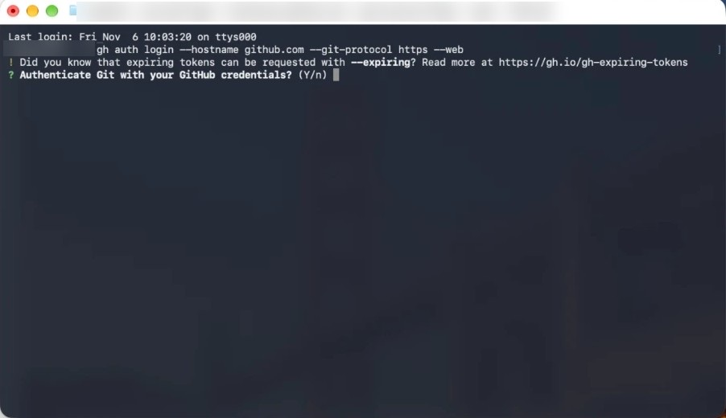
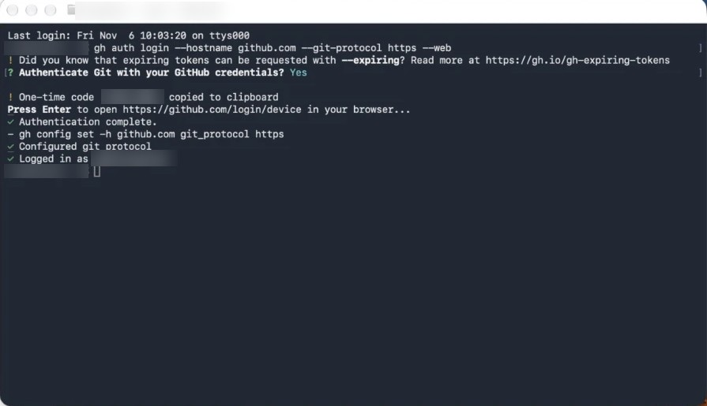

# Part 10. Connect your GitHub account

[Back to the contents](../README.md#the-guide)

Use **your own** GitHub account. Do this on the Mac mini through Screen Sharing.

## Step 35. Install the GitHub CLI

In a Claude chat on your Mac mini, ask: **Install the GitHub CLI.**

Or download the macOS installer from **cli.github.com**.

## Step 36. Start the login in Terminal

1. Open **Terminal**.
2. Paste this and press Return:

```bash
gh auth login --hostname github.com --git-protocol https --web
```

Run this one step yourself in Terminal. Claude's auto mode may block starting a login on its own. That's normal.

## Step 37. "Authenticate Git with your GitHub credentials? (Y/n)"

First you'll see a note, "Did you know that expiring tokens…". You can ignore it.

Type **Y** and press Return.



## Step 38. The one-time code

**Only now** does it show "One-time code (XXXX-XXXX) copied to clipboard". The code is already copied for you.

Press **Return**. It opens github.com/login/device in your browser.

## Step 39. Authorize in the browser

1. Sign in to **your own** GitHub account.
2. Paste the code (Cmd + V).
3. Click **Authorize**.

## Step 40. Check it

Back in Terminal you'll see "Authentication complete", "Configured git protocol" and "Logged in as" followed by your GitHub username. You're connected.



---

More parts (remote control from your phone, connections, phone lines) are coming. Watch the repo to get them.

Next: [Power and troubleshooting](power-and-troubleshooting.md)
